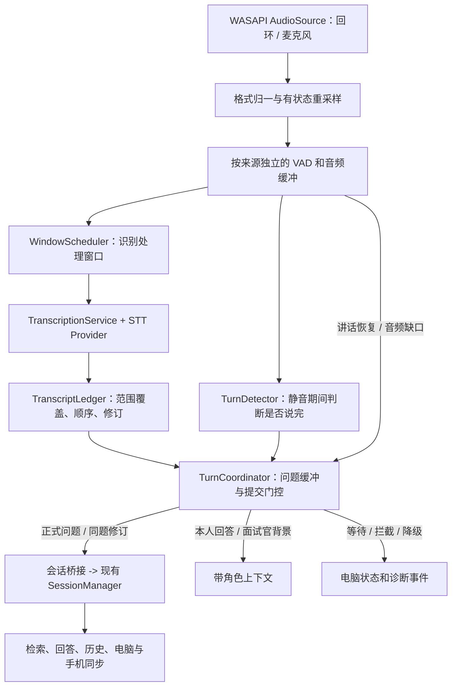

# 语音输入架构设计：连续音频与完整问题解耦

日期：2026-11-19。状态：设计成稿，待实施。代码基线：`3898132`，已发布至 `main`。本文不表示新语音流水线已经运行。

相关文档：[组件调研](2026-11-19-speech-pipeline-research.md)、[实施计划](2026-11-19-speech-implementation-plan.md)、[既有 v2 设计](superpowers/specs/2026-09-23-v2-incremental-architecture-design.md)。本文更新旧设计中音频分段、转写交接和成题部分；会话、回答取消、资料事实边界和手机权限继续沿用现有实现。

## 1. 核心决策

**不再把“某个音频块处理结束”当作“面试官的问题结束”。18 秒不能决定出题，也不简单改成另一个秒数。**

音频仍需要有限的处理窗口，以限制请求大小、显存和延迟；这些窗口只属于识别后端。问题可以跨任意多个窗口，累计完整文字，直到面试官说完且识别结果齐全才提交。时间、内存或队列超过保护阈值时进入可见的等待/异常状态，不能因此自动回答半个问题。

首选组合为本地 faster-whisper、前置 Silero VAD、本地 Smart Turn，以及应用自己的转写账本和问题协调器。先保留现有 Whisper 后端；FunASR 两遍识别作为可替换后端评测，避免同时改动所有变量。

## 2. 当前问题的具体来源

当前正式路径为：

```text
WASAPI -> copilot.audio.AudioEngine
       -> 音量阈值 / 静音 900ms / 最长 18000ms 切音频
       -> 本地 STT 返回 text
       -> _on_event(type="question")
       -> QuestionMerger 的文字与定时判断
       -> _start_question -> SessionManager -> 回答模型
```

18 秒切块本身并不直接调用回答模型；问题是下游主要看已回来的文字和定时器，不知道面试官是否仍在讲话、后面还有多少音频尚未识别。第一块返回后，合并器可能把部分文字当成完整问题。

现有 `src` 中的 `Segmenter` 也继承了 18 秒切块规则；`Transcript` 只保存文字和序号；`TranscriptionService` 有有界队列与取消，但尚未装配至正式入口。`transcript_to_legacy_event()` 直接把转写映射为 `question`。因此，单独启用已有 v2 标记或仅替换 VAD，仍不能解决问题。

## 3. 范围与不变量

1. 采集继续在电脑后台完成，系统回环和本人麦克风各自独立；手机只显示正式问题与回答。
2. 音频处理窗口、一次 ASR 最终稿、一个完整问题是三种不同对象，不能共用结束标记。
3. 正在持续讲话时，技术切块不得触发新题。切块参数变化不应改变最终问题文本及题目数量。
4. 咳嗽、轻声、短停顿和背景陈述分别处理；不能只根据音量、问号或是否命中个人资料判断有效性。
5. 关键数字、否定和个人经历不由模型猜改；原始转写、修订与依据分开保存。
6. 每个异步结果绑定输入身份、音频范围和修订号；旧会话、旧设备、旧判断均不得写入当前问题。
7. 自动成题只有一个写入入口；影子流水线不得产生题目、回答调用或额外本人上下文。
8. 新对话或重建语音通道不撤销手机配对。整个服务进程重启仍遵循当前配对失效规则。

本次不迁移整个前端、重做回答系统或引入完整 WebRTC 平台。会议应用级回环隔离、声学回声消除是独立候选能力，不假定普通 VAD 可以代替。

## 4. 目标结构和职责



| 模块 | 负责 | 明确边界 |
| --- | --- | --- |
| `AudioSource` / WASAPI adapter | 设备选择、PCM、采样时间、设备错误 | 保留 PortAudio 单线程访问与关闭规则，不在回调中跑 HTTP/模型 |
| 音频预处理与 VAD | 有状态重采样、帧适配、人声开始/恢复/暂停、缺帧 | 不判断问题含义；Silero 每一路独立模型状态 |
| `WindowScheduler` 与音频缓冲 | 识别窗口预算、上下文重叠、尾音保留、音频水位 | 切块原因是 transport，不是 question_end |
| `TranscriptionService` / provider | 有界调度、识别、超时、可选二次复核 | 批式与流式统一事件输出，不直接调用问答 |
| `TranscriptLedger` | 按音频范围归并最终稿、覆盖水位、修订及缺口 | 禁止按网络返回先后简单拼接文字 |
| `TurnDetector` | 根据最新音频尾部给出说完/未说完/未知 | 不修正文字，不决定是否与资料相关 |
| `TurnCoordinator` | 关联问题、等待条件、角色、质量、提交和补充 | 唯一自动成题决策者；慢模型在锁外运行 |
| 会话桥接 | 将正式提交/修订交给现有会话、历史和 SSE | 原始转写不再一律映射为旧 `question` 事件 |

`TranscriptionService` 作为现有服务的增量扩展；不保留两套同时生效的自动成题逻辑。新的协调器接管后，原 `QuestionMerger` 只供 legacy 模式使用。

## 5. 四层数据边界

| 对象 | 生命周期 | 必须携带的信息 |
| --- | --- | --- |
| `AudioFrame` | 连续采集的基础单位 | session、source、input_epoch、序号、采样区间、PCM 格式、采集时钟 |
| `AudioWindow` | 一次识别请求或流式区间 | window_id、音频起止、正文归属区间、左右上下文、切块原因、是否结束采集 |
| `TranscriptUpdate` | 对某段音频的识别/修订 | span_id、revision、覆盖范围、raw_text、normalized_text、ASR 是否最终、可选质量与事件标签 |
| `QuestionDraft` / `QuestionCommit` | 一个候选/正式问题 | draft_id、来源片段与范围、question_revision、提交原因、质量状态、可选 turn_id |

`is_asr_final` 只说明某段音频的识别完成，不等于 `question_complete`。纯文本 provider 也可接入：质量字段为 `null`，能力表明确不支持置信度/词时间戳，不能填 0 或伪造高置信度。

内部身份区分如下：

- `session_id`：面试会话，沿用现有类型。
- `source_id + input_epoch`：某个设备来源的一次输入生命周期；停止、换设备、新会话时旧 epoch 失效。
- `window_id / span_id + revision`：识别对象及其版本；重复版本幂等，较旧版本拒收。
- `activity_version`：该来源最近一次讲话活动变化；EOT 判断必须匹配此版本及 audio_end_sample。
- `draft_id + question_revision`：一个完整问题的构建和修订；正式提交后绑定同一个 `turn_id`。
- 现有 `TaskContext.generation`：回答任务身份，继续由 `SessionManager` 管理，不拿它代替输入 epoch。

既有 `AudioSegment`、`Transcript` 的调用方通过兼容适配逐步迁移，避免一次性破坏全部构造函数。新范围模型放入 `domain/speech.py`，在稳定后再统一旧模型。

## 6. 连续音频、时钟与长题

### 6.1 音频时间轴

每一路以归一化后的连续采样序号定位音频，内部使用半开区间 `[start_sample, end_sample)`；UTC 仅用于历史展示，超时使用单调时钟。两路采样轴不同，通过共同单调时钟锚点比较重叠，不能直接比较两个来源的 sample_index。

48kHz 到 16kHz 等重采样应保持跨帧状态和分数相位；不在每个输入包重置。设备丢帧、暂停或重开形成显式 gap/新 epoch，不能压缩时间轴假装连续。

### 6.2 后端窗口与问题缓冲分离

- 优先在低语音活动处形成 ASR 窗口；持续讲话时根据后端请求/延迟预算形成技术切块，并保留必要边界上下文。
- 切块带 `cut_reason=transport_budget` 等标记，继续使用同一个 draft；不会产生正式问题或结束候选句。
- 窗口大小由后端能力、排队情况和可用停顿控制。所有数值都是可校准的处理预算，不是问题最大时长。
- 只有已获得稳定转写的音频才能按保留策略释放；长题的早期音频可以退出环形缓冲，但完整文字和来源区间持续累计。
- 如果尚未处理的音频将被缓冲覆盖，必须记录 gap 并阻止该题自动提交。文本超出上下文预算时提示人工处理，不能静默截掉前提或自动另起一题。

例如面试官连续讲 55 秒，即使形成多次 6 秒附近的请求，也只有一份持续扩展的 draft。第 18 秒没有任何特殊成题动作。问题结束后，覆盖齐全、EOT 与质量条件通过，才生成一道包含前后条件的正式题目。

### 6.3 边界重叠与修订

有时间戳的后端按正文归属区间接收词/短语，重叠区只用作上下文；同一 span 的最终修订覆盖旧版本，不能追加成第二份文字。边界词无法明确归属时，复识别跨边界联合区间并原子替换受影响 spans。

无可靠时间戳的后端默认使用不重叠正文窗口，保留边界待复核信息；必要时联合复识别。不能用简单字符串去重删除正常的重复词，也不能把长题全部重新发送一遍才允许提交。无法消除的重要歧义进入待确认。

## 7. 说完判断与提交状态机

### 7.1 两个独立状态

来源活动状态为 `idle / speaking / quiet / impaired / stopped`。问题状态为 `empty / collecting / evaluating / awaiting_transcript / needs_review / committed / cancelled`。讲话与识别并行，不强行合成一个“录音结束”状态。

| 输入事件 | 问题状态变化与动作 |
| --- | --- |
| 有效语音开始 | 创建/继续 draft，进入 collecting；只显示识别进度 |
| 技术窗口到达预算 | 送识别，draft 不结束 |
| VAD 检测安静 | 请求最新音频尾部的 EOT 判断，进入 evaluating |
| EOT 判断期间恢复讲话 | 递增 activity_version，丢弃旧 EOT 结果，回 collecting |
| EOT 为未说完/未知 | 保留全文继续等；未知过久进入 needs_review |
| EOT 为说完但识别未齐 | awaiting_transcript，显示仍在识别，不启动回答 |
| 所有条件通过 | 原子记录 QuestionCommit，绑定 turn_id，再触发回答 |
| 噪声/非语音得到确认 | 记录拦截原因；不建立题目 |
| 新对话、停止、换设备 | 使受影响 epoch 与判断失效；保留可追溯的取消状态 |

### 7.2 自动提交的必要条件

所有条件在协调器同一次状态检查中通过：

1. 输入会话/epoch 仍有效，面试官来源当前没有继续讲话。
2. EOT 结果对应最新 activity_version 和候选终点，且达到当前语言/模型配置的阈值。
3. 到候选语音终点的连续音频都已经被最终识别或被可靠确认无语音；不能有未完成请求、待修订 span、缺口或质量隔离区间。候选终点后的下一题音频不属于这道题的屏障。
4. 所有窗口按音频顺序归并完毕，关键歧义已解决；问题不是仅有噪声或明确背景。
5. 当前 draft_revision 尚未提交，或形成了一次允许的正式同题修订。

候选终点建立时必须把尾部未发送音频送入 ASR。`finalized_through_sample` 表示连续覆盖水位，不能用“最大的返回序号”代替。超时失败的窗口不能被水位跨过。

采集 owner 先发布最新 activity_version 和输入状态，再投递后续异步工作。正式提交使用短锁或等价的 compare-and-swap 再核对 epoch、activity_version 与 draft_revision，避免“新语音已经到达，但通知还排在旧 EOT 结果后面”的竞态；不能依靠前端状态是否更新判断。

### 7.3 不是用更长的定时器代替判断

最短静音窗口用于避免频繁推理，稳定等待用于合并邻近修订，最大等待用于提示异常。最大等待不代表可以强制回答，也不覆盖“正在讲话”条件。

Smart Turn 使用最近最多 8 秒音频判断停顿性质；完整问题上下文仍在 ledger/draft，不受这个输入窗口限制。短音频按模型输入约定补齐，旧判断在新语音后失效。模型失败时可显式降级为“静音 + 文本完整性”的保守模式，并标明能力下降；未通过完整性检查的内容保留待确认，提供手动提交。

### 7.4 已提交后的补充

同题补充先关联 draft/turn_id，暂停旧回答；补充稳定后提升 question_revision，调用现有 `revise_turn`，由 SessionManager 取消旧 generation，并生成新答案。一次补充事件簇只触发一次修订，不随每个 token 重答。

关联依据包含音频时间、明确补充线索、主题和当前互动状态。已有本人实质回答、手动换题或明确新问题时不自动回写旧题；关联不确定则等待人工选择。有限的关联窗口只用于保留候选关系，不能单独决定是否同题，也不能丢掉窗口外识别出的有效问题。

如果说话人在一个表面完整的句子后长停顿，再临时补充条件，端点模型仍可能误判。架构通过同题修订与保守待确认降低影响，不承诺单靠端点模型消灭所有抢答。

## 8. 质量与语义门控

| 决策 | 典型依据 | 后续行为 |
| --- | --- | --- |
| `accept_question` | 完整有效提问/指令，满足提交屏障 | 提交给检索与回答 |
| `wait` | 前提没说完、低质量、关键歧义、识别未齐 | 等新语音或做有限复识别 |
| `context_only` | 可靠的背景陈述或本人回答 | 保存角色上下文，不触发问答 |
| `reject` | 明确非语音、空结果、重复幻觉 | 记录原因与计数 |
| `needs_review` | 缺口、超时、不可消除歧义、预算耗尽 | 展示原文，允许编辑/提交/放弃 |

质量证据综合 VAD、识别指标、音频事件、重复性、边界覆盖与上下文；不同后端的 confidence 不统一按同一个阈值解释。纯文本后端缺失质量字段并不自动拒绝，使用已有证据并标为未知。

清晰的新领域问题、没有检索命中的技术题仍可通过。语义判断可复用已有 `question_flow.py` 的保守线索，识别不清时提供候选术语；不得把“与简历不相关”作为拒绝条件，也不以额外大模型逐段改写作为默认前置依赖。

“如果我们有三年的数据……”这类场景前提应继续留在 draft；不能提前作为普通背景移出问题。已经确认的背景也保留来源与后续题目关联，以便最终提交时携带必要条件。

`raw_text` 不可被覆盖；`normalized_text` 的词项修订记录依据和置信状态。改变数字、否定、对象身份或个人事实的修改必须待确认。咳嗽标签只屏蔽对应事件，不能删除同句真实问题。

## 9. 调度、异常与生命周期

- 每路采集只有一个 owner；音频回调不执行识别、文件 I/O 或长时间持锁。
- 当前单 GPU/后端先使用共享有界识别调度，面试官优先、本人通道有公平性保障；并发数由实测决定，不能只给两路各加线程导致显存竞争。
- 队列同时限制待处理音频时长与任务数，跟踪最老音频年龄；过载先停止低优先级复核，随后进入 impaired。无法保留的区间记 gap，不把“丢掉最老任务后继续回答”作为正常降级。
- 重试按错误类型和剩余音频年龄预算进行。鉴权/请求错误不反复重试；恢复后不自动把过时问题作为最新问题发送。
- `stop` 和换设备默认取消未提交 draft；已显示的部分文字可供人工恢复，不把停止动作解释为“问题完整”。只重建受影响来源。
- `new_session` 原子切换两路输入归属、取消旧识别/EOT/计时器、清 draft 与上下文，再广播 session_reset；手机授权继续迁移，不能调用 revoke_all。
- 关闭时先停止采集、失效 epoch，再在有限时间内收尾网络与 worker，flush 历史。无法物理取消的推理只允许记诊断，不允许写入新会话。

## 10. 事件、历史和界面

电脑端新增 `speech_activity`、`transcript_update`、`speech_draft`、`speech_decision` 和 `speech_gap`；通过现有 ReplayEventHub 发布，包含输入身份和修订号，不含 PCM 或绝对路径。重连快照包含当前草稿与状态，避免等到下一条增量才恢复。

提交层内部使用 `question_committed` / `question_revised`，桥接到既有正式题目、answer_start 和历史接口。旧 `question` 类型不再同时代表原始转写和正式成题。手动提问保留，显式关闭或分离当前面试官 draft，防止手动题后又自动冒出同一份草稿。

手机仍只投影正式问题、回答和简化采集状态；不添加原始转写/待确认内容。新增事件被过滤时仍保持 cursor 连续；新会话和正常重连保持当前配对。

历史复用现有事件存储，保存有界的原文/修订、处理范围、决策原因和正式题目的关联；数据库迁移采用追加方式，旧 510 条记录不重写。每次修订保留原问题与旧答案版本信息；现有 turns 仍提供当前正式文本。音频默认仅在内存保留，诊断录音由用户主动开启，写入被 Git 忽略的 data 目录并有保留上限。

电脑界面显示“正在听”“仍在识别”“等待补充”“待确认”及可编辑草稿，并提供明确的提交/放弃操作。草稿变化不创建回答卡。状态说明服务于用户判断当前输入状态，不暴露模型内部实现细节。

## 11. 配置与渐进切换

当前试用实现采用以下扁平配置，`config.example.json`为可直接使用的入口；数值仍需真人样本校准。最初设计的嵌套配置未作为另一套兼容格式实现：

```json
{
  "speech": {
    "mode": "legacy",
    "window_ms": 6000,
    "max_window_ms": 12000,
    "pre_roll_ms": 300,
    "min_quiet_ms": 500,
    "commit_quiet_ms": 1400,
    "review_after_ms": 8000,
    "audio_ring_ms": 120000,
    "vad_threshold": 0.5,
    "endpoint_threshold": 0.65
  }
}
```

`mode`是唯一运行模式开关，当前支持`legacy/active`，未指定时默认legacy。设计中的运行时shadow仍待实现，当前明确拒绝该值，以离线回放作对照；将来shadow必须共用一次采集、使用有界只读tap，不能另开设备或挤压主链路。旧`v2_transcription_enabled`不作为当前装配入口。

`max_window_ms`只限制单次识别窗口；`review_after_ms`只改变UI状态；`audio_ring_ms`只限制内存保留。三者都不是题目结束条件。当前共享队列限制为24秒待处理音频、12个任务、10秒队列年龄；尚未开放独立配置。参数验证数值及时间预算关系，质量阈值按模型版本记录。

旧 `audio.max_segment_ms` 仅在 legacy 路径生效。active 路径不隐式继承它，更不能通过把它设成无限大来规避架构问题。切换输入模式在暂停两路采集后执行，重建输入 epoch，但不重建 SessionManager、不清历史、不撤销手机。

本地 STT 目前位于仓库外。首阶段按仓库已有补丁方式交付可审阅的结构化输出补丁，记录适用版本与部署前后哈希，保留纯 text 兼容；不能只修改外部文件却让 GitHub 上的代码无法复现。模型和独立 STT 虚拟环境不搬迁。

## 12. 验收原则

必须证明技术窗口长度变化不会改变同一录音的题目数量与核心文本；覆盖持续 55/120 秒、18 秒附近跨句、2/4/6 秒中途停顿、句末晚到识别、两遍修订、乱序、缺口、超时、换设备与新会话。确定性回放验证架构不变量，真实中文语音验证模型效果，两类证据分开。

首轮真实语音目标为相对基线减少至少 50% 的误触发与抢答，有效问题召回下降不超过 2 个百分点。延迟、CER、数字/否定与术语准确率分别报告，不把总体平均 CER 当成正确回答保证；这些是实施验收目标，当前没有达成声明。

具体任务、交付物和退出条件见[实施计划](2026-11-19-speech-implementation-plan.md)。
