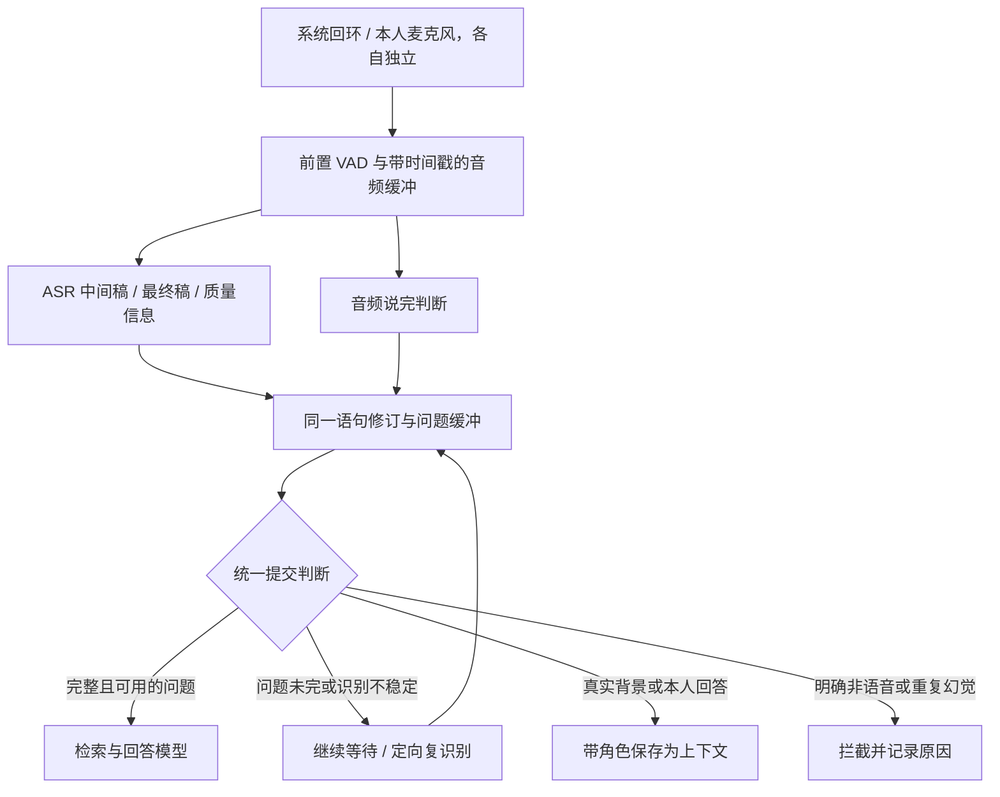

# 语音模块调研与改造建议

调研日期：2026-11-19。结论基于当前代码和当天读取的官方文档、源码；候选模型尚未在本机安装或比较实测。本文中的实施阶段均为建议，不代表已接入。

后续方案已细化为[连续语音架构设计](2026-11-19-speech-architecture-design.md)与[实施计划](2026-11-19-speech-implementation-plan.md)。音频处理窗口不再承担问题结束语义；具体状态机、完整性屏障与切换规则以设计文档为准。

## 结论

有成熟组件可以分别改善人声检测、识别修订和说完判断，但没有单个模型可以可靠解决所有“无关或错误字句进入回答模型”的问题。

建议先保留现有 Windows 双通道采集和本地 faster-whisper，补齐结构化识别结果与统一提交门控，再加入 Silero VAD 和本地 Smart Turn。中文识别和延迟仍不达标时，用同一批音频比较 FunASR 两遍识别，再决定是否更换后端。这样可以分别验证每一层的收益。

“与个人材料关联度低”和“无效语音”必须分开。清楚的陌生技术问题仍应进入回答流程，由回答模型使用通用知识；不能因为简历检索没有命中就丢弃。

## 当前实现与缺口

| 环节 | 已有实现 | 本次核实的缺口 |
| --- | --- | --- |
| 采集 | 电脑 WASAPI 回环与本人麦克风分开，16kHz 单声道送识别 | 回环采集所选播放设备的声音，可能包含其他应用音频；不是按会议应用隔离 |
| 客户端分段 | `copilot/audio.py` 用音量阈值，预留开头音频 | 当前配置每帧 100ms、静音 900ms 切段、最长 18 秒；响声不一定是人声，安静不一定说完 |
| 本地识别 | `hermes-stt/stt_server.py` 使用 faster-whisper，默认 `large-v3-turbo` | 已开 `vad_filter=True`，beam=5、temperature=0、关闭前文条件、抑制重复；不能把这些已有配置当作新优化 |
| 识别输出 | 服务和客户端最终只交接 `text` | 丢弃时间戳、分段平均 log probability、无语音概率等信息，主程序缺少质量判断依据 |
| 问题合并 | `server.py` 的 `QuestionMerger` 支持缓冲、未完句、续句修订 | 主要依靠时间和文字规则；在识别错字时也会受到影响 |
| 背景与噪声 | `question_flow.py` 过滤口头词、重复文字和明确背景 | 规则覆盖有限；尚无统一的“接受、等待、背景、拒绝”决策记录 |
| 排队 | 当前音频引擎使用单 worker 的 `ThreadPoolExecutor` | 提交处没有队列容量或音频年龄上限；识别变慢时存在积压旧音频的风险 |
| 新架构 | 已有 `TranscriptionService`、`Transcript`、provider 接口 | 正式 `server.py` 当前仍装配 `copilot.audio.AudioEngine`；只改 v2 类不会自动改善正式入口 |

`C:\Users\29557\hermes-stt\stt_server.py` 的 `duration_ms` 当前取推理耗时，并不是音频时长，后续结构化协议应拆为 `processing_ms` 与 `audio_duration_ms`。音频引擎发出的片段时长按样本数计算，应保留该来源。

已有 `data/stt-quality-after-20261118.json` 只验证了合成中文语音、静音、白噪声与稳态噪声。这不能证明真实咳嗽、多人说话、英语术语及长停顿已解决；本轮没有重做真实录音验收。

## 候选方案

### 1. Silero VAD：前置人声检测

- 官方支持 8kHz/16kHz，可用 ONNX，本地 CPU 运行，MIT 许可。
- 适合在客户端阻止大量非语音片段进入 ASR。每一路独立保存 VAD 状态，并保留 pre-roll，避免吞掉开头字。
- 需要适配模型规定的输入帧长，不能直接把当前 100ms 帧原样传入。
- 它只判断有没有人声，不能判断是不是问题、是否相关；咳嗽和混合声也可能误判。
- 后端 faster-whisper 已用 VAD；前置 VAD 的价值是更早分段和减少请求，不是简单重复打开同一个开关。双层阈值过严会漏掉轻声，应联合校准。

来源：[Silero 官方仓库](https://github.com/snakers4/silero-vad)。

### 2. faster-whisper：优先利用现有后端的质量信息

- 官方 `Segment` 提供 `avg_logprob`、`no_speech_prob`、`compression_ratio`、时间范围和可选词信息。
- 优先扩展本地 STT 返回协议，再让当前客户端保留这些字段；默认仍可返回兼容的 `text`。
- `hallucination_silence_threshold` 官方说明依赖 `word_timestamps=True`，不能只加一个参数就认为生效。
- `no_speech_threshold` 与低 log probability 联合影响静音跳过；不能把某个数值当作所有场景通用的硬阈值。
- 这些指标不是校准过的“答案正确概率”。缺失字段应标为未知；数字、否定词和术语即使置信度高也可能识别错误。
- 热词只提供紧凑术语表，比较有热词与无热词结果；不把整个资料库作为识别提示。

来源：[faster-whisper 官方源码及参数说明](https://github.com/SYSTRAN/faster-whisper/blob/master/faster_whisper/transcribe.py)。

### 3. Smart Turn：解决“停几秒还没问完”

- Pipecat 官方 Smart Turn 是基于原始音频的说完判断模型，支持中文，提供本地 CPU/ONNX 推理示例，BSD-2-Clause。
- 官方推荐与 Silero 配合，在静音出现后判断是否说完；音频中重新出现语音时，必须使旧判断失效并重新评估。
- 输入为 16kHz 单声道，最多最近 8 秒。长题保留完整文字上下文，不能因为模型只看 8 秒就丢弃前面的条件。
- 官方 README 当前标题为 v3.2，但示例推理代码仍引用 v3.1 权重文件；实施时应固定匹配的代码、权重与校验值。
- 它不负责纠正转写，不负责判断内容与面试是否相关，也不能保证消除所有抢答。
- 建议作为首选本地端点模型 PoC。官方性能数字不作为本机延迟承诺，Windows 环境仍需实测。

来源：[Smart Turn 官方仓库与输入约定](https://github.com/pipecat-ai/smart-turn)、[官方推理代码](https://github.com/pipecat-ai/smart-turn/blob/main/inference.py)。

### 4. FunASR 两遍识别：更完整的中文实时方案

- 官方在线 runtime 提供 `online`、`offline` 和 `2pass`，两遍方案先实时转写，句末再校正并加标点；支持热词。
- 先显示 `2pass-online` 中间稿，使用 `2pass-offline` 修订同一语句，避免将两个版本误当两道题。
- ASR 句末最终稿仍不等于完整问题，仍需说完判断和问题缓冲。
- 流式方案使用专门的 Paraformer streaming checkpoint；SenseVoiceSmall 是非流式识别模型，不能因为推理快就称为原生流式。
- SenseVoice 可识别 `<|Cough|>`、`<|Breath|>` 等事件。保留事件标签后可作为辅助证据；一句话里含咳嗽不应整句删除。
- sherpa-onnx 支持 Windows、流式与非流式模型，可作为较轻的本地部署候选，但引擎和模型需要分别选择。FunASR 官方两遍容器方案在 Windows 上通常还涉及 Docker/WSL，不能直接等同于现有 Python 服务的即插即用替换。
- 工具库许可与模型权重许可分开检查。最终根据本人中文技术场景测 CER、术语和数字准确率，不采用官方跨数据集的性能比值替代比较。

来源：[FunASR 官方仓库](https://github.com/modelscope/FunASR)、[官方两遍 runtime 文档](https://github.com/modelscope/FunASR/blob/main/runtime/docs/SDK_advanced_guide_online.md)、[官方 WebSocket 客户端](https://github.com/modelscope/FunASR/blob/main/runtime/python/websocket/funasr_wss_client.py)、[SenseVoice 官方说明](https://github.com/FunAudioLLM/SenseVoice)、[sherpa-onnx 官方仓库](https://github.com/k2-fsa/sherpa-onnx)。

### 5. LiveKit：整体语音会话框架的备选

- 官方当前推荐音频 TurnDetector，支持中文；完整模型涉及 LiveKit Inference/Cloud 凭据，本地 `v1-mini` 使用 CPU，按 LiveKit Model License。
- 官方已将旧的文本 turn detector 标为 deprecated，并计划在 SDK 2.0 移除。新接入不应照旧教程选文本模型。
- 如果以后需要 WebRTC、多端语音和统一语音会话管理，可以评估整体框架。当前项目以电脑双通道采集和手机只读显示为主，完整迁移收益尚不足以抵消改造成本。
- 部署时必须明确选择本地或云端版本，不能将 SDK 默认回退行为误认为全程本地处理。

来源：[LiveKit 官方 Turn Detector 文档](https://docs.livekit.io/agents/build/turns/turn-detector/)。

## 建议的统一处理链路

统一判断不以“是否有问号”作为唯一依据。“介绍一下你的项目”也应通过；“如果我们有三年数据……”可能是题目前提，应暂存并合并。

建议内部事件包含 `source_id`、`generation`、`segment_id`、`revision`、音频起止时间、`raw_text`、`normalized_text`、`is_final`、可选质量字段以及提交结果/原因。中间稿仅供显示；最终稿可修订同一语句。轮次正式提交后，晚到补充沿用现有 turn_id 与取消旧生成机制，限制重答次数，避免抖动。

“上下文猜测”应限定为带依据的词项候选：例如 RAG 专名候选可结合近期话题，但保留原文和修改记录。否定、数字、公司名、项目成果不能靠语言模型猜改。听不清的关键点进入等待或待确认状态，不能用流畅改写掩盖不确定。

本人回答只进入本人上下文；面试官背景可供下一题参考，但不直接启动回答。说话角色使用既有独立采集来源，不把匿名声纹聚类标签当作可靠身份。对扬声器串音、系统提示音和会议外播放声音另做测试，不能靠问答 LLM 修复音频来源错误。

## 分阶段落地与验收

1. **先补质量接口和门控。** 为正式 AudioEngine 链路保留结构化识别结果、原因日志和有界队列；增加排队年龄、积压可见状态。过期片段不再默默触发旧题回答，也不能悄悄丢弃有用问题。兼容当前返回纯文本的 provider。
2. **接入 Silero + Smart Turn。** 独立配置、可随时回退；使用音频时钟与 generation 取消，恢复讲话即取消旧端点判断。结合文本未完句规则及可配置最大等待，防止永久等待。
3. **做中文后端 A/B。** 用相同音频比较现有 Whisper、Paraformer 两遍识别、SenseVoice 句末复核。先离线评测，之后影子运行；只有证据支持时才切换默认后端。低质量片段可二次识别，不默认双模型识别每段。
4. **完善操作与复盘。** 电脑端显示原始稿、修订稿、等待/拦截原因，提供编辑后提交与手动结束当前问题。手机继续只收正式问题和回答，不扩大原始音频或私人资料的分发范围。

评测集建议至少覆盖：静音/咳嗽/键盘/提示音，中文夹英文术语，数字与否定，轻声，2/4/6 秒中途停顿，长题补充，面试官背景说明，本人回答，陌生但有效技术题，以及重复启动、切会话和网络慢导致的晚到结果。

同时统计真实问题召回率与误触发率、中文 CER、术语/数字/否定准确率、错误修订率、抢答率、说完到提交的 P50/P95、重答次数和队列音频年龄。建议首轮目标为相对当前基线将误触发与抢答减少至少一半，同时有效问题召回下降不超过 2 个百分点；这是待评测的验收目标，不是已经达到的结果。

现有历史仅有识别文字时，可以复现文字路由问题，无法证明原始音频说了什么。真实音频评测应由用户提供可用样例或主动开启测试录音；本轮未开启录音、下载模型或向外部语音服务发送个人音频。

## 本轮已完成：手机配对保留

- 新对话会将已有设备授权迁移至当前会话，token 与原有到期时间不变；未兑换的旧配对码失效。
- 手机通过 `session_reset` 清除旧题并跟随新对话；刷新和断线重连保持授权。
- 显式撤销、手机退出和 8 小时授权到期仍生效。配对目前保存在进程内，服务重启后仍需重新配对。
- 验证：Python `tests` 全量 414 项通过，手机浏览器回归 9 项通过，包含连续三次新对话、同一 cookie、断线重连、刷新、撤销与窄屏布局。浏览器测试为本机双端口模拟，不代表真实手机 Wi-Fi/锁屏验收。
- 已用 Ctrl+C 平稳重启正式服务，电脑 `127.0.0.1:8527`、手机 `0.0.0.0:8528` 就绪，实际手机脚本含新会话处理。两路采集保持关闭，后台无生成任务；510 条历史 turns 与重启前备份逐行一致、SHA-256 一致，SQLite 完整性检查通过。隔离预览已关闭。
